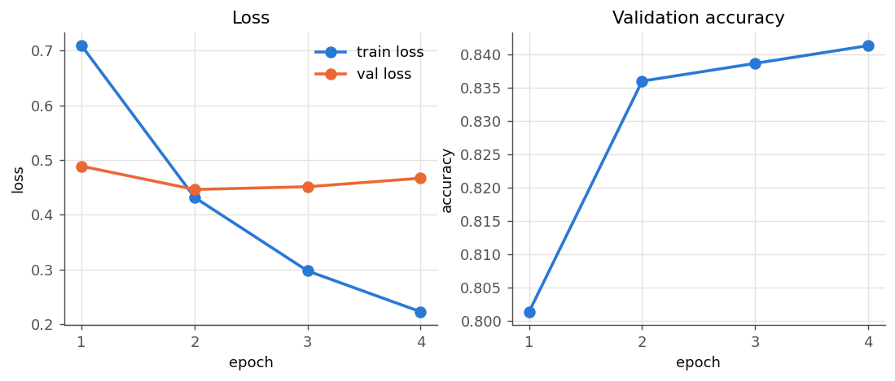
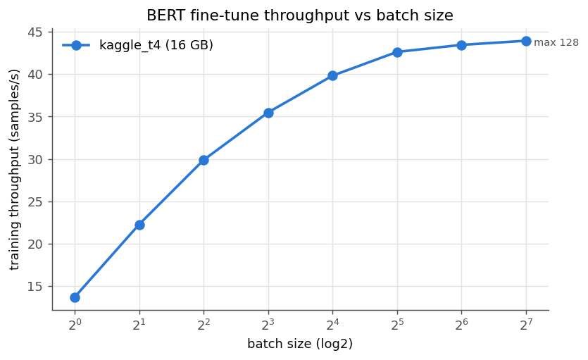

# METRICS — HW4.a and HW4.5 (GPU Assignment II)

Generated by `make_report.py` from `results/`. GPU UUIDs: see `env/`. Written answers come from `ANSWERS.md`.

## Data (same as HW4.a) and GPU used

- Dataset: **Twitter US Airline Sentiment**, file `Tweets.csv` (sha256 `ea94b23f41892b29…`), text column `text`, label column `airline_sentiment`.
- Exact row range: **605..5604 (0-based data rows, inclusive)** = CSV lines 607..5606 (1-based file lines, header = line 1), i.e. up to 5,000 consecutive rows starting at SLICE; 5000 rows used, labels ['negative', 'neutral', 'positive'].
- Split: train/val/test = 3500/750/750 (70/15/15) with **SEED = 1605**; split fingerprint `0a40f6dcbc3f9a20…`.

Same-data check: **60 of 60** training result files (HW4.a, Parts A, B, C) used exactly these rows and this split. No rows were re-picked and nothing was reshuffled.

GPU (`nvidia-smi -L`, uuid_colab_t4.txt):

```
GPU 0: Tesla T4 (UUID: GPU-e3bcdb6e-864d-471e-7372-88021ba40a10)
```

GPU (`nvidia-smi -L`, uuid_kaggle_t4.txt):

```
GPU 0: Tesla T4 (UUID: GPU-8cd406d2-0d44-2d5f-f41e-0f7b6d2d317a)
```

## HW4.a — BERT fine-tune and vLLM inference

### HW4.a fine-tune on `kaggle_t4` (Tesla T4)

- Dataset: **Twitter US Airline Sentiment** (`data/Tweets.csv`), rows **605..5604 (0-based data rows, inclusive)** (SLICE=605, SEED=1605), 5000 rows used (0 dropped for missing values); split train/val/test = 3500/750/750 (70/15/15, SEED).
- Settings: bert-base-uncased, batch 32, lr 2e-05, epochs 4, max_len 128, fp32, AdamW.

| Epoch | Train loss | Val loss | Val acc | Epoch time (s) |
|---|---|---|---|---|
| 1 | 0.7093 | 0.4889 | 0.8013 | 76.0 |
| 2 | 0.4318 | 0.4463 | 0.8360 | 80.5 |
| 3 | 0.2974 | 0.4513 | 0.8387 | 80.8 |
| 4 | 0.2227 | 0.4669 | 0.8413 | 80.0 |

Validation loss stopped improving after **epoch 2** (best val accuracy at epoch 4). Training 2 more epoch(s) cost 160.8 s of GPU time, raised val loss by +0.0206 and changed val accuracy by +0.0053.

**Test accuracy 0.8213.** Confusion matrix (rows = true, columns = predicted):

| true \ pred | negative | neutral | positive |
|---|---|---|---|
| negative | 433 | 34 | 20 |
| neutral | 40 | 97 | 13 |
| positive | 10 | 17 | 86 |

| Class | Precision | Recall | F1 | Support |
|---|---|---|---|---|
| negative | 0.896 | 0.889 | 0.893 | 487 |
| neutral | 0.655 | 0.647 | 0.651 | 150 |
| positive | 0.723 | 0.761 | 0.741 | 113 |

Worst class (lowest F1): **neutral**. Five misclassified test examples (most confident mistakes first):

| # | Tweet | Predicted (conf) | Diagnosis |
|---|---|---|---|
| 1 | @united it just goes round &amp; round, it's be going on for weeks, | negative (0.988) | Labelled neutral, but the text is a complaint about a weeks-long runaround, so this looks like a label error; "negative" is a reasonable prediction. |
| 2 | @united @paigeworthy : page United values your tweet b/c it's so rare that they receive tweets complimenting their service...most are fake. | negative (0.985) | Sarcasm: the literal words ("values your tweet", "complimenting") are positive while the meaning is a jab at United, and the gold label of neutral is itself debatable. |
| 3 | @united Lindsay and ??.  Darn.  Terrible memory on my part.  I know they are headed back to IAD and then PIT tonight. | negative (0.984) | The negative words ("Darn", "Terrible memory") are aimed at the writer's own memory, not the airline; the model scores sentiment words without knowing what they are aimed at. |
| 4 | @united You please do not burn my dreams !!!  #burningman tickets sales today. | negative (0.982) | Wordplay on #burningman: "burn my dreams" plus "!!!" reads as distress, but it is a request about ticket sales, which the model cannot tell apart. |
| 5 | @united @retailbagholder hahaha. At least they gave u a refund. | negative (0.979) | A reply in someone else's thread: "at least they gave u a refund" implies a bad trip, and whether it counts as neutral depends on context the model never sees. |

**HW4 baseline for HW4.5:** peak GPU memory **3.99 GB** allocated (4.39 GB reserved), wall-clock training time **317.4 s** (343.4 s including per-epoch validation).

Reloaded-model custom inference:

| Text | Prediction | Confidence |
|---|---|---|
| The flight was delayed three hours and nobody told us anything. | negative | 0.981 |
| Crew was friendly and we landed early, great job! | positive | 0.946 |
| Is there wifi on the 7am flight to Denver? | neutral | 0.907 |



### HW4.a.2 — vLLM inference on `kaggle_t4` with `Qwen/Qwen2.5-0.5B-Instruct` (a different Hugging Face model, own prompt)

Prompt: *Explain what a KV cache is to a first-year student.*

Output:

> A key component of a computer's memory system, a K cache stores recently accessed data in memory. It is volatile, meaning that its contents are lost when power is lost, and it is sequential, meaning that it is accessed in order of last access. The data stored in a K cache is typically in the form of hash keys and values. The K cache is typically used to speed up the performance of applications that access frequently accessed data. A K cache is not used for storing large amounts of data because it is limited by the amount of memory that can be used and the size of the data that needs to be stored. A K cache is not used to store data that is not frequently accessed because it is not used for that purpose. A K cache is used to speed up the performance of applications that access frequently accessed data by storing the data in memory and retrieving it when needed. The K cache is not used to store large amounts of data because it is limited by the amount of memory that can

### Table HW4.1 — Serving comparison

#### Serving on `kaggle_t4` — model `Qwen/Qwen2.5-0.5B-Instruct`, 128 new tokens/request

| Configuration | Tokens/sec | p50 latency (ms) | p95 latency (ms) | Requests/sec |
|---|---|---|---|---|
| HF pipeline, batch 1 | 25.0 | 4,999.4 | 5,616.0 | 0.19 |
| vLLM, batch 1 | 138.4 | 921.4 | 963.3 | 1.08 |
| vLLM, batch 8 | 1,008.2 | 998.4 | 1,053.0 | 7.88 |
| vLLM, batch 32 | 2,937.3 | 1,394.4 | 1,395.9 | 22.95 |

Measured facts for question 6: vLLM per-request p50 latency stays at or below the HF batch-1 baseline (4999 ms) at every batch measured; the latency crossing is above batch 32.

In the measured range, per-request latency never becomes worse than the HF batch-1 baseline. vLLM's p50 rises from 921 ms at batch 1 to 998 ms at batch 8 and 1,394 ms at batch 32, which is still 3.6× below HF's 4,999 ms, so the crossing point is above batch 32. Against vLLM's own batch 1, per-request latency gets worse at every step (p95 +9% at batch 8, +45% at batch 32) while total throughput rises 7.3× and 21× (138 → 1,008 → 2,937 tok/s). For an interactive application the per-request latency (especially p95, the tail users notice) is the number that matters, not aggregate tokens/s. On this T4, batch 8 is the sweet spot: 7× the throughput for about 9% more latency. (All requests in a batch are submitted together, so latency here is the batch's wall time; time-to-first-token was not measured.)

## Part A — Batch scaling to the memory wall

### `kaggle_t4` (Tesla T4, 15.64 GB)

| Batch | Throughput (samp/s) | Peak alloc (GB) | Peak reserved (GB) | Time / epoch (s) |
|---|---|---|---|---|
| 1 | 13.7 | 2.21 | 2.45 | 255.4 |
| 2 | 22.3 | 2.22 | 2.51 | 157.1 |
| 4 | 29.9 | 2.22 | 2.44 | 117.2 |
| 8 | 35.5 | 2.25 | 2.45 | 98.6 |
| 16 | 39.8 | 2.65 | 3.00 | 87.9 |
| 32 | 42.6 | 3.99 | 4.19 | 82.1 |
| 64 | 43.4 | 6.51 | 6.72 | 80.6 |
| 128 | 43.9 | 11.67 | 11.86 | 79.7 |

Largest batch that runs: **128** (batch 256: OOM). Throughput stops improving (next doubling < 5% gain) beyond batch **32**.



Only one GPU was used (one GPU is enough per the HW4.5 clarifications), so the max-batch ratio vs VRAM ratio comparison between two cards does not apply.

## Part B — Memory techniques, measured one at a time

### Table HW4.5.1 — `colab_t4` (Tesla T4, 15.64 GB)

Throughput, peak memory and accuracy are from a full HW4-settings run (batch 32, 4 epochs); max batch is the largest power of two that trains.

| Technique | Max batch | Throughput (samp/s) | Peak memory (GB) | Eval accuracy |
|---|---|---|---|---|
| Baseline (HW4 settings) | 128 | 52.4 | 3.99 | 0.8293 |
| Mixed precision (float16) | 256 | 171.9 | 3.24 | 0.8067 |
| Best combination (float16) | 256 | 171.2 | 2.58 | 0.8080 |
| Best combination + grad ckpt (float16) | 1024 | 132.9 | 1.25 | 0.8160 |

Ranking by memory saved per unit of throughput lost (GB saved ÷ % throughput lost; ∞ = saves memory with no throughput loss):

| Rank | Technique | Memory saved (GB) | Throughput lost (%) | GB per % lost |
|---|---|---|---|---|
| 1 | Mixed precision | 0.75 | none (227.8% faster) | ∞ |

### Table HW4.5.1 — `kaggle_t4` (Tesla T4, 15.64 GB)

Throughput, peak memory and accuracy are from a full HW4-settings run (batch 32, 4 epochs); max batch is the largest power of two that trains.

| Technique | Max batch | Throughput (samp/s) | Peak memory (GB) | Eval accuracy |
|---|---|---|---|---|
| Baseline (HW4 settings) | 128 | 43.3 | 3.99 | 0.8213 |
| Gradient checkpointing | 512 | 31.9 | 2.24 | 0.8213 |
| Gradient accumulation (8×16) | 2048 effective (128 physical) | 41.9 | 2.46 | 0.7880 |
| 8-bit optimiser | 128 | 43.1 | 3.29 | 0.8253 |

Gradient checkpointing: throughput 31.9 vs 43.3 samp/s = **26.2% slower** (the extra forward recomputation during backward).

| Run | Physical batch | Effective batch | Optimiser steps | Train time (s) | Peak (GB) | Test acc |
|---|---|---|---|---|---|---|
| accumulation | 8 | 128 | 113 | 333.9 | 2.46 | 0.7880 |
| direct large batch | 128 | 128 | 112 | 313.8 | 11.67 | 0.7787 |

Ranking by memory saved per unit of throughput lost (GB saved ÷ % throughput lost; ∞ = saves memory with no throughput loss):

| Rank | Technique | Memory saved (GB) | Throughput lost (%) | GB per % lost |
|---|---|---|---|---|
| 1 | 8-bit optimiser | 0.69 | 0.4 | 1.871 |
| 2 | Gradient accumulation (vs direct effective batch) | 9.20 | 6.0 | 1.527 |
| 3 | Gradient checkpointing | 1.75 | 26.2 | 0.067 |

### Ranking of the four techniques (all cards)

Each technique's memory saved and throughput lost are measured against the baseline on the card it ran on, so the percentages are comparable even though the cards' absolute throughputs differ.

| Rank | Technique | Memory saved (GB) | Throughput lost (%) | GB per % lost |
|---|---|---|---|---|
| 1 | Mixed precision (`colab_t4`) | 0.75 | none (227.8% faster) | ∞ |
| 2 | 8-bit optimiser (`kaggle_t4`) | 0.69 | 0.4 | 1.871 |
| 3 | Gradient accumulation (vs direct effective batch) (`kaggle_t4`) | 9.20 | 6.0 | 1.527 |
| 4 | Gradient checkpointing (`kaggle_t4`) | 1.75 | 26.2 | 0.067 |

Part B was measured on two T4 sessions. The Kaggle T4 table covers gradient checkpointing, gradient accumulation and 8-bit AdamW. The Colab T4 table covers mixed precision and the combinations, each against a fp32 baseline rerun on that same GPU. Compare absolute numbers only within one table (the combined ranking uses percentages against each card's own baseline): the identical fp32 baseline ran at 43.3 samples/s on Kaggle (torch 2.8) and 52.4 on Colab (torch 2.11). The first Kaggle AMP runs used emulated bf16 and are kept only in `superseded/`.

Apply first: **mixed precision (fp16 + GradScaler)**. On the Colab T4 it raised throughput from 52.4 to 171.9 samples/s (3.3×, because the T4's tensor cores run fp16), cut peak memory from 3.99 to 3.24 GB, and doubled the max batch from 128 to 256. It is the only technique that saves memory and time at once. Test accuracy was 0.8067 vs 0.8293, while final val accuracy was higher (0.847 vs 0.840). Since the same fp32 baseline itself differed by 0.8 points between the two T4s, part of that gap is run-to-run noise. Next is **8-bit AdamW**, which saved 0.69 GB for 0.4% throughput. Combined with fp16 ("best combination") it ran at 171.2 samples/s in 2.58 GB. Gradient accumulation (8 × 16: 2.46 GB vs 11.67 GB for a direct batch of 128, 6% slower) is the tool for reaching a large effective batch. Gradient checkpointing gave the lowest memory (1.25 GB with fp16 + 8-bit, max batch 1,024), but it cost 26.2% throughput in fp32 and 22.4% on top of fp16 + 8-bit. On a 32 GB card I would not bother with gradient checkpointing (or accumulation): the HW4 settings need only 2.6–4 GB there, so the memory it frees is not needed and the throughput it costs is real.

## Part C — Two cards at once

**Part C skipped (optional)**

## Part D — Serving, revisited on real hardware

#### Serving on `kaggle_t4` — model `Qwen/Qwen2.5-0.5B-Instruct`, 128 new tokens/request

| Configuration | Tokens/sec | p50 latency (ms) | p95 latency (ms) | Requests/sec |
|---|---|---|---|---|
| HF pipeline, batch 1 | 25.0 | 4,999.4 | 5,616.0 | 0.19 |
| vLLM, batch 1 | 138.4 | 921.4 | 963.3 | 1.08 |
| vLLM, batch 8 | 1,008.2 | 998.4 | 1,053.0 | 7.88 |
| vLLM, batch 32 | 2,937.3 | 1,394.4 | 1,395.9 | 22.95 |

Measured facts for question 6: vLLM per-request p50 latency stays at or below the HF batch-1 baseline (4999 ms) at every batch measured; the latency crossing is above batch 32.

#### KV cache on `kaggle_t4` — `Qwen/Qwen2.5-1.5B-Instruct` (float16), batch 8, gpu_memory_utilization 0.9

KV bytes/token = 2 (K,V) × 28 layers × 2 KV heads × 128 head_dim × 2 B = **28.0 KiB**. vLLM reserved a KV pool of **362,144 tokens (10.38 GB)**, so the longest context at batch 8 is **32,768 tokens** (limited by model max_position_embeddings; verified by a real batch-8 run: yes).

| Context | KV cache at batch 8 (GB) | Fits |
|---|---|---|
| 256 | 0.06 | yes |
| 512 | 0.12 | yes |
| 1,024 | 0.23 | yes |
| 2,048 | 0.47 | yes |
| 4,096 | 0.94 | yes |
| 8,192 | 1.88 | yes |
| 16,384 | 3.76 | yes |
| 32,768 | 7.52 | yes |

The HW4.a serving run (08:13 in RUN_LOG.txt) and the Part D rerun (10:44) used the same Tesla T4, model (Qwen2.5-0.5B-Instruct), precision (float16) and attention backend, and agree within 2.5%. HF batch 1 gave 24.7 vs 25.0 tok/s. vLLM gave 135.1 vs 138.4 tok/s at batch 1, 994.9 vs 1,008.2 at batch 8 and 2,923.4 vs 2,937.3 at batch 32, with p50 within 2% (923/921, 1,017/998, 1,401/1,394 ms). Differences that small are run-to-run noise (GPU clock and thermal state on a shared Kaggle host), not a hardware or precision effect. Both runs write the same result files, so the tables above show the Part D run; the HW4.a numbers are in RUN_LOG.txt. One hardware caveat applies to both runs: the T4 has no FlashAttention 2, and vLLM's FlexAttention fallback crashed with an illegal memory access, so serving used `VLLM_ATTENTION_BACKEND=TRITON_ATTN`; an Ampere or newer card would be faster. For the KV cache, Qwen2.5-1.5B needs 28 KiB per token, and vLLM's 10.38 GB pool holds 362,144 tokens (45,268 per sequence at batch 8). The longest context at batch 8 is therefore capped by the model's 32,768-token limit rather than by memory: 8 × 32,768 tokens use 7.52 GB, and a real batch-8 run at that length succeeded.

## Part E — Analysis and summary (HW4.5 summary — not an HW5 baseline)

### `colab_t4`

One full fine-tune = 70% of all 14,640 rows = 10,248 training samples × 4 epochs = 40,992 samples. GPU-hours = samples ÷ throughput ÷ 3600:

| Configuration | Throughput (samp/s) | Calculation | GPU-hours |
|---|---|---|---|
| Baseline (HW4 settings) | 52.4 | 40,992 / 52.4 / 3600 | 0.217 |
| Mixed precision | 171.9 | 40,992 / 171.9 / 3600 | 0.066 |
| Best combination | 171.2 | 40,992 / 171.2 / 3600 | 0.066 |
| Best combination + grad ckpt | 132.9 | 40,992 / 132.9 / 3600 | 0.086 |

**HW4.5 summary (best measured configurations):**

| Criterion | Configuration | Peak memory (GB) | Throughput (samp/s) | Wall-clock train time (s) | Test acc |
|---|---|---|---|---|---|
| Lowest peak memory | Best combination + grad ckpt | 1.25 | 132.9 | 105.4 | 0.8160 |
| Highest throughput | Mixed precision | 3.24 | 171.9 | 81.5 | 0.8067 |
| Shortest wall-clock | Mixed precision | 3.24 | 171.9 | 81.5 | 0.8067 |

### `kaggle_t4`

One full fine-tune = 70% of all 14,640 rows = 10,248 training samples × 4 epochs = 40,992 samples. GPU-hours = samples ÷ throughput ÷ 3600:

| Configuration | Throughput (samp/s) | Calculation | GPU-hours |
|---|---|---|---|
| Baseline (HW4 settings) | 43.3 | 40,992 / 43.3 / 3600 | 0.263 |
| Gradient checkpointing | 31.9 | 40,992 / 31.9 / 3600 | 0.357 |
| 8-bit optimiser | 43.1 | 40,992 / 43.1 / 3600 | 0.264 |

**HW4.5 summary (best measured configurations):**

| Criterion | Configuration | Peak memory (GB) | Throughput (samp/s) | Wall-clock train time (s) | Test acc |
|---|---|---|---|---|---|
| Lowest peak memory | Gradient checkpointing | 2.24 | 31.9 | 438.5 | 0.8213 |
| Highest throughput | Baseline (HW4 settings) | 3.99 | 43.3 | 323.4 | 0.8213 |
| Shortest wall-clock | Baseline (HW4 settings) | 3.99 | 43.3 | 323.4 | 0.8213 |

I would use **mixed precision + 8-bit AdamW at batch 32 (the "best combination")**. On the Colab T4 it trains at 171.2 samples/s, so one full fine-tune on 70% of all 14,640 rows for 4 epochs costs **0.066 GPU-hours**, versus 0.217 for the fp32 baseline on the same GPU (and 0.263 on the Kaggle T4). It peaks at 2.58 GB, so memory is far from the limit. Its test accuracy, 0.8080, is within run-to-run variation of the baselines (0.8213 and 0.8293). Adding gradient checkpointing would raise the cost to 0.086 GPU-hours for memory that is not needed. Validation loss in this run was lowest at epoch 3 (0.450, rising to 0.461 at epoch 4), so stopping after 3 epochs would cut the cost to about 0.05 GPU-hours without losing accuracy. On a lab RTX 4090/5090, `--amp auto` would pick native bf16 instead of fp16 (no GradScaler needed), with the same choice of configuration.
